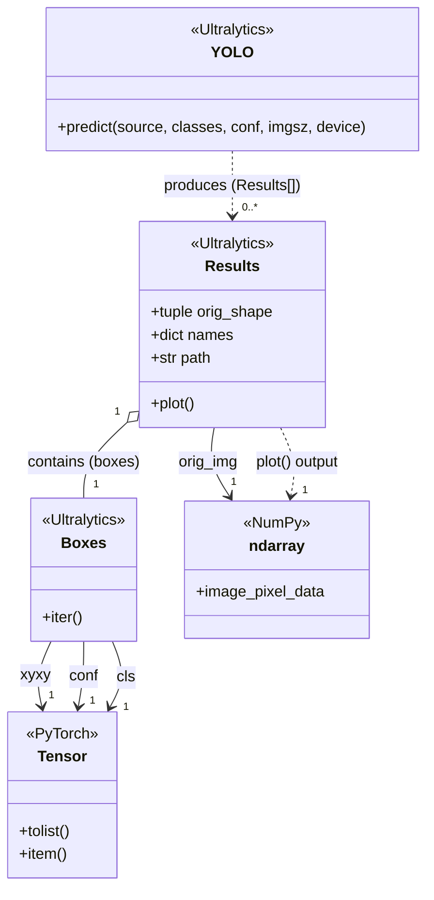
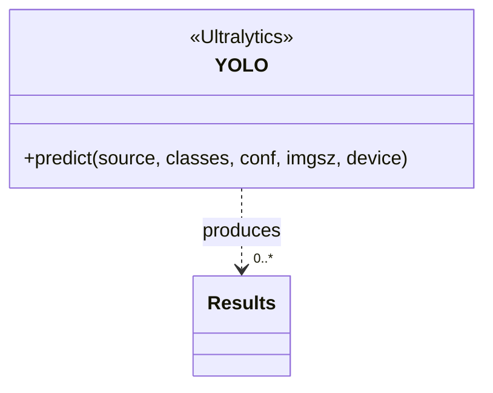
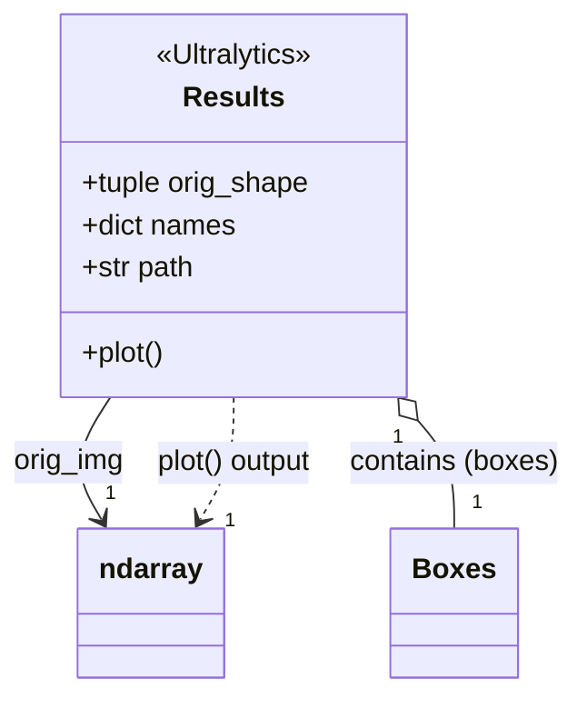
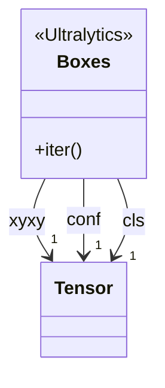
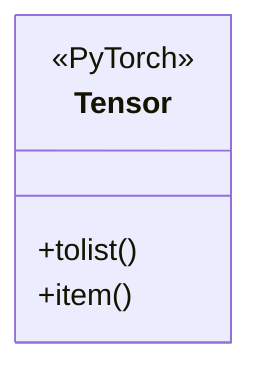
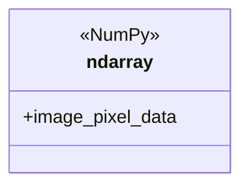
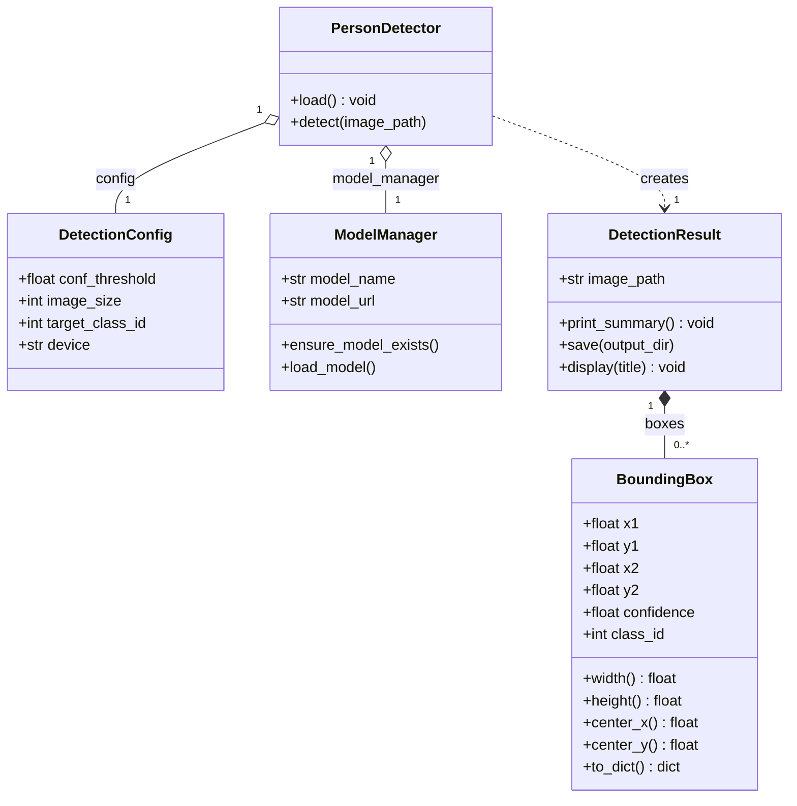

# UML Architecture & Class Diagrams

## 1. Visualization Specification (Rules for Diagramming)

This specification governs how object properties and relationships must be rendered in all UML class diagrams across this project:

| Category | Definition & Examples | UML Placement |
| :--- | :--- | :--- |
| **Primitive Instance Variables** | Single scalar values of types `int`, `float`, `str`, `bool`. <br>*(e.g., `path: str`, `conf_threshold: float`, `image_size: int`, `confidence: float`)* | **Internal Attribute** (inside class box compartment) |
| **Collections Holding Primitives** | Data structures (`tuple`, `list`, `dict`, `set`) whose items are primitive types. <br>*(e.g., `orig_shape: tuple[int, ...]`, `names: dict[int, str]`)* | **Internal Attribute** (inside class box compartment) |
| **Non-Primitive Instance Variables** | References to instances of other classes or complex objects. <br>*(e.g., `orig_img: ndarray`, `boxes: Boxes`, `xyxy: Tensor`, `model_manager: ModelManager`, `config: DetectionConfig`)* | **Outer Relation / Association** (connecting line/arrow between class boxes; **NOT** written inside the box) |
| **Collections Holding Non-Primitives** | Data structures (`list`, array, generator) holding references to non-primitive class instances. <br>*(e.g., `results: Results[]`, `boxes: List[BoundingBox]`)* | **Outer Relation / Association** with multiplicity (e.g., `1` to `0..*`) |

---

## 2. Runtime Class Diagram (`detections.ipynb` / Ultralytics Engine)

This diagram models the internal classes and execution flow executed in [`detections.ipynb`](file:///Users/startup/projects/yolotest/detections.ipynb) (Ultralytics YOLO, OpenCV, PyTorch, and NumPy), strictly formatted according to the Visualization Specification:



---

## 3. Code-to-UML Walkthrough: Connecting `detections.ipynb` One by One

Here is how each block in the diagram maps directly to the code cells in [`detections.ipynb`](file:///Users/startup/projects/yolotest/detections.ipynb).

---

### Block 1: `«Ultralytics» YOLO`



#### Your Present Code in `detections.ipynb`
* **Cell 4** (Instantiation):
  ```python
  model = YOLO(str(MODEL_PATH))
  ```
* **Cell 7** (Executing the Operation):
  ```python
  results = model.predict(
      source=str(image_path),
      classes=[PERSON_CLASS_ID],
      conf=CONFIDENCE_THRESHOLD,
      imgsz=IMAGE_SIZE,
      device=DEVICE
  )
  ```

#### How It Maps to the Diagram:
1. **Class Name**: `YOLO` (loaded from `from ultralytics import YOLO` in Cell 2).
2. **Operation**: `+predict(source, classes, conf, imgsz, device)` represents the method you call in Cell 7.
3. **Outer Relation (`produces 0..* Results`)**: Calling `model.predict()` returns `results`, which is a list containing `Results` objects (one for each input image). Because a list of `Results` is a **collection holding non-primitive objects**, it is drawn as an outer arrow pointing to `Results`.

---

### Block 2: `«Ultralytics» Results`



#### Your Present Code in `detections.ipynb`
* **Cell 8** (Iterating through results and accessing boxes):
  ```python
  for result in results:
      for index, box in enumerate(result.boxes):
  ```
* **Cell 9** (Calling plot):
  ```python
  result_image = results[0].plot()
  ```

#### How It Maps to the Diagram:
1. **Class Name**: `Results` — each element inside the `results` list is an instance of this class.
2. **Attributes Compartment**:
   * `orig_shape: tuple`: The original dimensions `(height, width)` of your image (collection of primitives).
   * `names: dict`: Mapping of class IDs to labels `{0: 'person'}` (collection of primitives).
   * `path: str`: The file path string of the input image (primitive).
3. **Operations Compartment**:
   * `+plot()`: The function called in Cell 9 to render bounding boxes onto the image.
4. **Outer Relations**:
   * `contains (boxes)`: In Cell 8, `result.boxes` accesses an instance of the `Boxes` class. It is a non-primitive object, so it is an outer aggregation arrow.
   * `plot() output`: In Cell 9, `results[0].plot()` returns a pixel array of type `ndarray` (NumPy), drawn as an outer dependency arrow.

---

### Block 3: `«Ultralytics» Boxes`



#### Your Present Code in `detections.ipynb`
* **Cell 8** (Iterating and accessing coordinate properties):
  ```python
  for index, box in enumerate(result.boxes):

      x1, y1, x2, y2 = box.xyxy[0].tolist()
      ...
      confidence = box.conf[0].item()
      class_id = int(box.cls[0].item())
  ```

#### How It Maps to the Diagram:
1. **Class Name**: `Boxes` — the container holding all detected persons for the image.
2. **Operations Compartment**:
   * `+iter()`: Enables Python's `for box in result.boxes:` loop in Cell 8.
3. **Outer Relations (`xyxy`, `conf`, `cls`)**:
   * `box.xyxy`, `box.conf`, and `box.cls` are **PyTorch Tensors** (non-primitive objects), so each connects via an outer arrow to the `Tensor` class block.

---

### Block 4: `«PyTorch» Tensor`



#### Your Present Code in `detections.ipynb`
* **Cell 8** (Converting GPU/CPU Tensors to standard Python values):
  ```python
  x1, y1, x2, y2 = box.xyxy[0].tolist()
  ...
  confidence = box.conf[0].item()
  class_id = int(box.cls[0].item())
  ```

#### How It Maps to the Diagram:
1. **Class Name**: `Tensor` (from PyTorch).
2. **Operations Compartment**:
   * `+tolist()`: Called on `box.xyxy[0]` to convert multi-dimensional tensor coordinates `[x1, y1, x2, y2]` into a native Python list.
   * `+item()`: Called on `box.conf[0]` and `box.cls[0]` to extract the single scalar value as a native Python `float` or `int`.

---

### Block 5: `«NumPy» ndarray`



#### Your Present Code in `detections.ipynb`
* **Cell 9** (Converting color channels and displaying):
  ```python
  result_image = results[0].plot()

  plt.figure(figsize=(12, 8))
  plt.imshow(cv2.cvtColor(result_image, cv2.COLOR_BGR2RGB))
  ```
* **Cell 10** (Writing image to file):
  ```python
  output_path = OUTPUT_DIR / image_path.name
  cv2.imwrite(str(output_path), result_image)
  ```

#### How It Maps to the Diagram:
1. **Class Name**: `ndarray` (from NumPy).
2. **Attributes Compartment**:
   * `image_pixel_data`: The raw 3-dimensional array of pixels `[height, width, 3]` representing RGB/BGR colors.
3. **Usage**:
   * OpenCV (`cv2.cvtColor`, `cv2.imwrite`) and Matplotlib (`plt.imshow`) directly accept this `ndarray` object to manipulate, render, and save the picture.

---

## 4. Application Architecture Diagram ([`detector.py`](file:///Users/startup/projects/yolotest/detector.py))

This diagram models the object-oriented Python wrapper created in [`detector.py`](file:///Users/startup/projects/yolotest/detector.py), wrapping the low-level runtime engine into clean, reusable classes under the exact same specification:




---

## 5. End-to-End Image Detection Pipeline

```mermaid
flowchart LR
    A["dataset/images/*.jpg"] --> B["Image Loader / Path"]
    B -->|image path or matrix| C["YOLO Model (predict)"]
    C -->|Results[]| D["Results (plot)"]
    D -->|annotated_image (ndarray)| E["cv2.imwrite"]
    E --> F["runs/person_detection/*.jpg"]
```
