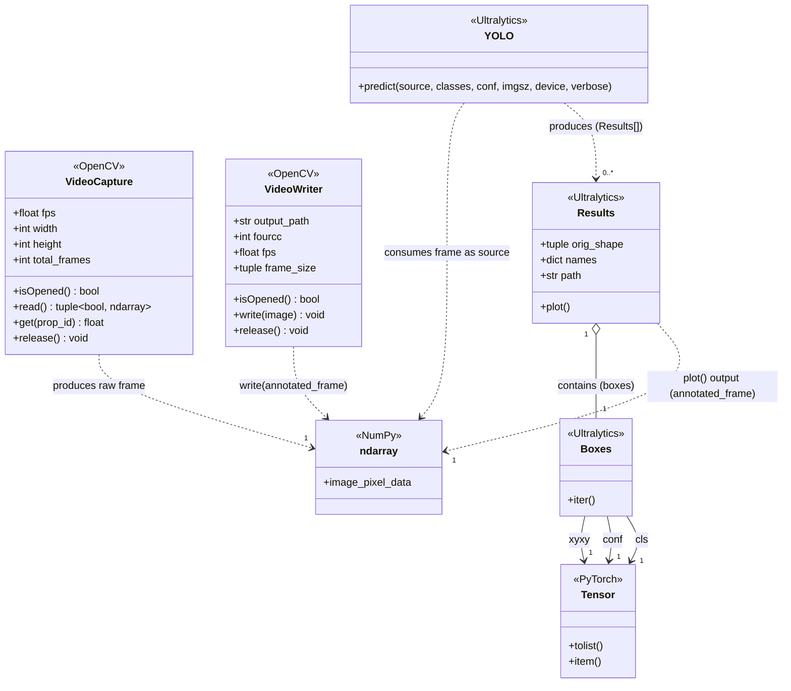
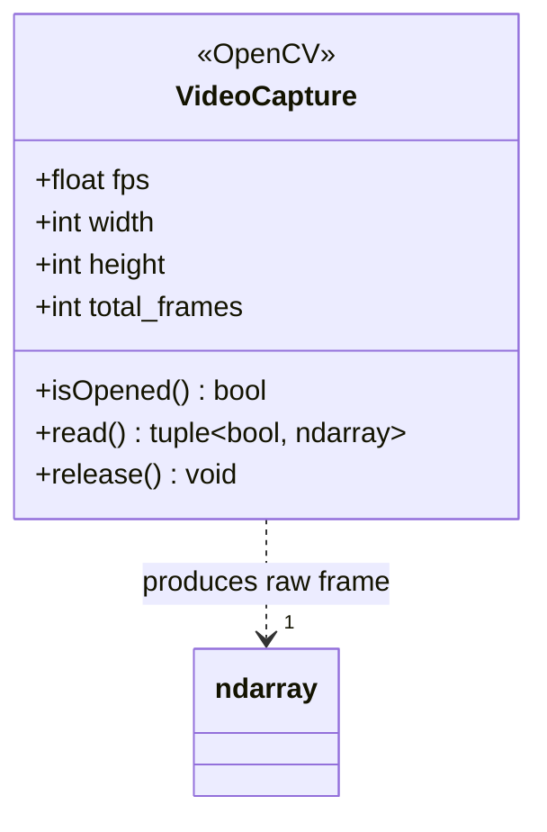
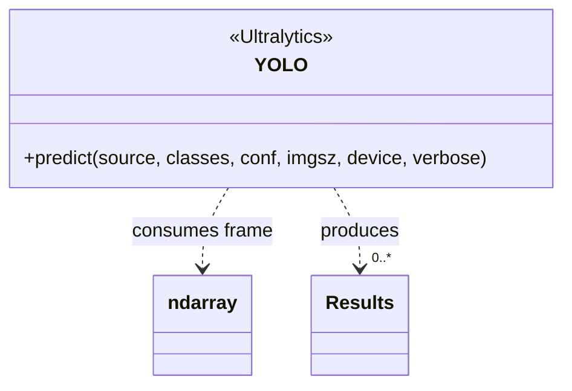
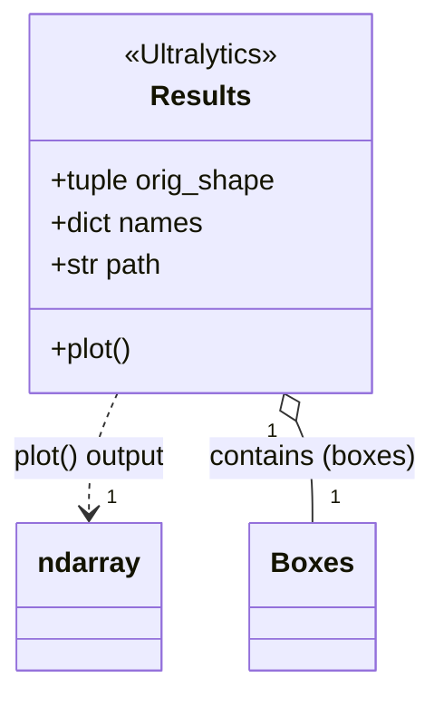
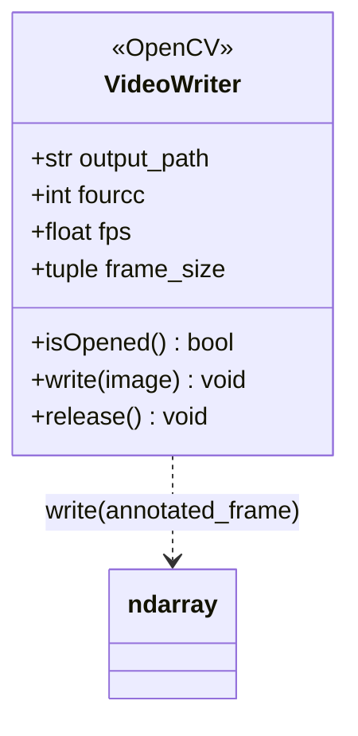
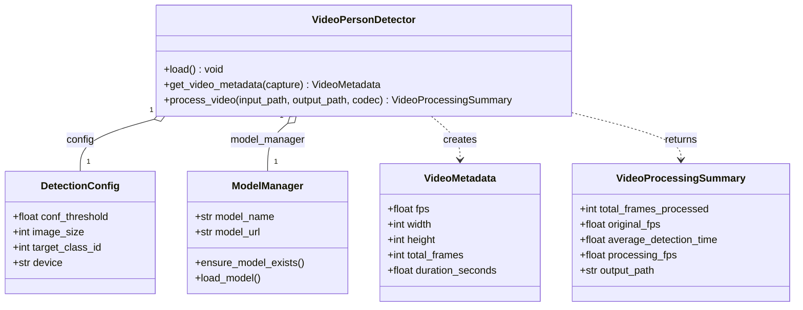

# Video Person Detection Architecture & Class Diagrams

## 1. Visualization Specification (Rules for Diagramming)

This specification governs how object properties and relationships must be rendered in all UML class diagrams across this project:

| Category | Definition & Examples | UML Placement |
| :--- | :--- | :--- |
| **Primitive Instance Variables** | Single scalar values of types `int`, `float`, `str`, `bool`. <br>*(e.g., `fps: float`, `width: int`, `height: int`, `total_frames: int`, `output_path: str`)* | **Internal Attribute** (inside class box compartment) |
| **Collections Holding Primitives** | Data structures (`tuple`, `list`, `dict`, `set`) whose items are primitive types. <br>*(e.g., `frame_size: tuple[int, int]`, `orig_shape: tuple[int, int]`, `names: dict[int, str]`)* | **Internal Attribute** (inside class box compartment) |
| **Non-Primitive Instance Variables** | References to instances of other classes or complex objects. <br>*(e.g., `frame: ndarray`, `boxes: Boxes`, `xyxy: Tensor`, `model_manager: ModelManager`, `config: DetectionConfig`)* | **Outer Relation / Association** (connecting arrow between class boxes; **NOT** written inside the box) |
| **Collections Holding Non-Primitives** | Data structures (`list`, array, generator) holding references to non-primitive class instances. <br>*(e.g., `results: Results[]`, `boxes: List[BoundingBox]`)* | **Outer Relation / Association** with multiplicity (e.g., `1` to `0..*`) |

---

## 2. Runtime Class Diagram (`video_detection.ipynb` / Stream Pipeline)

This diagram models the execution flow, classes, and interactions inside [`video_detection.ipynb`](file:///Users/startup/projects/yolotest/video_detection.ipynb) (OpenCV, Ultralytics YOLO, NumPy, and PyTorch), strictly formatted according to the Visualization Specification:



### Spec Compliance Breakdown (Runtime Diagram)

| Class | Element | Type Classification | Spec Rule Applied |
| :--- | :--- | :--- | :--- |
| `VideoCapture` | `fps`, `width`, `height`, `total_frames` | Primitives (`float`, `int`) | **Internal Attributes** in `VideoCapture` box |
| `VideoCapture` | `read()` output (`frame`) | Non-primitive object (`ndarray`) | **Outer Dependency** (`VideoCapture ..> ndarray`) |
| `VideoWriter` | `output_path`, `fourcc`, `fps` | Primitives (`str`, `int`, `float`) | **Internal Attributes** in `VideoWriter` box |
| `VideoWriter` | `frame_size` | Collection of primitives (`tuple[int, int]`) | **Internal Attribute** in `VideoWriter` box |
| `VideoWriter` | `write()` input (`annotated_frame`) | Non-primitive object (`ndarray`) | **Outer Dependency** (`VideoWriter ..> ndarray`) |
| `YOLO` | `predict()` source | Non-primitive object (`ndarray`) | **Outer Dependency** (`YOLO ..> ndarray`) |
| `YOLO` | `predict()` return | Collection of non-primitives (`Results[]`) | **Outer Dependency** (`YOLO ..> "0..*" Results`) |
| `Results` | `orig_shape`, `names`, `path` | Primitives / collections of primitives | **Internal Attributes** in `Results` box |
| `Results` | `boxes` | Non-primitive object (`Boxes`) | **Outer Aggregation** (`Results o-- Boxes`) |
| `Results` | `plot()` output | Non-primitive object (`ndarray`) | **Outer Dependency** (`Results ..> ndarray`) |
| `Boxes` | `xyxy`, `conf`, `cls` | Non-primitive objects (`Tensor`) | **Outer Associations** (`Boxes --> Tensor`) |

---

## 3. Code-to-UML Walkthrough: Connecting `video_detection.ipynb` One by One

Here is how each block in the diagram maps directly to the code cells in [`video_detection.ipynb`](file:///Users/startup/projects/yolotest/video_detection.ipynb):

---

### Block 1: `«OpenCV» VideoCapture` (Video Stream Input)



#### Code in `video_detection.ipynb`:
* **Cell 4** (Initialization & Metadata Extraction):
  ```python
  cap = cv2.VideoCapture(video_path)

  if not cap.isOpened():
      raise FileNotFoundError(...)

  fps = cap.get(cv2.CAP_PROP_FPS)
  width = int(cap.get(cv2.CAP_PROP_FRAME_WIDTH))
  height = int(cap.get(cv2.CAP_PROP_FRAME_HEIGHT))
  total_frames = int(cap.get(cv2.CAP_PROP_FRAME_COUNT))
  ```
* **Cell 6** (Reading Stream Frames in Loop):
  ```python
  while True:
      ret, frame = cap.read()
      if not ret:
          break
  ```
* **Cell 7** (Resource Cleanup):
  ```python
  cap.release()
  ```

#### How It Maps:
1. **Attributes**: `fps`, `width`, `height`, and `total_frames` are scalar numbers (`float`, `int`), placed in the attributes compartment.
2. **Operations**: `isOpened()`, `get()`, `read()`, and `release()` are the OpenCV methods called.
3. **Outer Relation**: `cap.read()` yields `frame`, which is a NumPy `ndarray` (non-primitive object).

---

### Block 2: `«Ultralytics» YOLO` (Frame Inference Engine)



#### Code in `video_detection.ipynb`:
* **Cell 2** (Loading Weights):
  ```python
  model = YOLO("yolo11n.pt")
  ```
* **Cell 6** (Predicting on Each Frame):
  ```python
  results = model.predict(
      source=frame,
      classes=[0],
      conf=0.25,
      imgsz=640,
      device="cpu",
      verbose=False
  )
  ```

#### How It Maps:
1. **Consumes `ndarray`**: `source=frame` takes the raw video frame (`ndarray`) from `VideoCapture`.
2. **Produces `Results[]`**: Returns a collection of `Results` objects for each frame, represented as an outer dependency arrow.

---

### Block 3: `«Ultralytics» Results` & `«NumPy» ndarray` (Annotated Frame Generation)



#### Code in `video_detection.ipynb`:
* **Cell 6** (Rendering Bounding Boxes):
  ```python
  annotated_frame = results[0].plot()
  ```

#### How It Maps:
1. **Attributes**: `orig_shape` (height, width tuple), `names` (dictionary of class labels), `path` (input source string).
2. **Operation**: `results[0].plot()` renders boxes, labels, and confidences on the current video frame.
3. **Outer Relation**: Returns `annotated_frame` as an `ndarray` (NumPy), which is passed to the video writer.

---

### Block 4: `«OpenCV» VideoWriter` (Video Output Stream)



#### Code in `video_detection.ipynb`:
* **Cell 5** (Writer Initialization):
  ```python
  fourcc = cv2.VideoWriter_fourcc(*"mp4v")
  out = cv2.VideoWriter(
      str(output_path),
      fourcc,
      fps,
      (width, height)
  )
  ```
* **Cell 6** (Writing Processed Frames):
  ```python
  out.write(annotated_frame)
  ```
* **Cell 7** (Finalizing Video):
  ```python
  out.release()
  ```

#### How It Maps:
1. **Attributes**:
   * `output_path`: file destination (`str`).
   * `fourcc`: video codec integer (`int`).
   * `fps`: frames per second (`float`).
   * `frame_size`: `(width, height)` resolution as a `tuple[int, int]` (collection of primitives).
2. **Operations**: `isOpened()`, `write()`, and `release()`.
3. **Outer Relation**: `out.write(annotated_frame)` consumes the non-primitive `ndarray` annotated frame and encodes it into `output.mp4`.

---

## 4. Application Architecture Diagram ([`video_detector.py`](file:///Users/startup/projects/yolotest/video_detector.py))

This diagram models the object-oriented Python implementation in [`video_detector.py`](file:///Users/startup/projects/yolotest/video_detector.py), applying the identical Visualization Specification:



### Spec Compliance Breakdown (Application Diagram)

| Class | Element | Type Classification | Spec Rule Applied |
| :--- | :--- | :--- | :--- |
| `VideoMetadata` | `fps`, `width`, `height`, `total_frames`, `duration_seconds` | Primitives (`float`, `int`) | **Internal Attributes** in `VideoMetadata` box |
| `VideoProcessingSummary` | `total_frames_processed`, `original_fps`, `average_detection_time`, `processing_fps`, `output_path` | Primitives (`int`, `float`, `str`) | **Internal Attributes** in `VideoProcessingSummary` box |
| `DetectionConfig` | `conf_threshold`, `image_size`, `target_class_id`, `device` | Primitives (`float`, `int`, `str`) | **Internal Attributes** in `DetectionConfig` box |
| `ModelManager` | `model_name`, `model_url` | Primitives (`str`) | **Internal Attributes** in `ModelManager` box |
| `VideoPersonDetector` | `config` | Non-primitive object (`DetectionConfig`) | **Outer Aggregation** (`VideoPersonDetector o-- DetectionConfig`) |
| `VideoPersonDetector` | `model_manager` | Non-primitive object (`ModelManager`) | **Outer Aggregation** (`VideoPersonDetector o-- ModelManager`) |
| `VideoPersonDetector` | `get_video_metadata()` return | Non-primitive object (`VideoMetadata`) | **Outer Dependency** (`VideoPersonDetector ..> VideoMetadata`) |
| `VideoPersonDetector` | `process_video()` return | Non-primitive object (`VideoProcessingSummary`) | **Outer Dependency** (`VideoPersonDetector ..> VideoProcessingSummary`) |

---

## 5. End-to-End Video Stream Pipeline

```mermaid
flowchart LR
    A["dataset/video.mp4"] --> B["cv2.VideoCapture"]
    B -->|raw frame (ndarray)| C["YOLO Model (predict)"]
    C -->|Results[]| D["Results (plot)"]
    D -->|annotated_frame (ndarray)| E["cv2.VideoWriter"]
    E --> F["runs/person_detection_video/output.mp4"]
```
