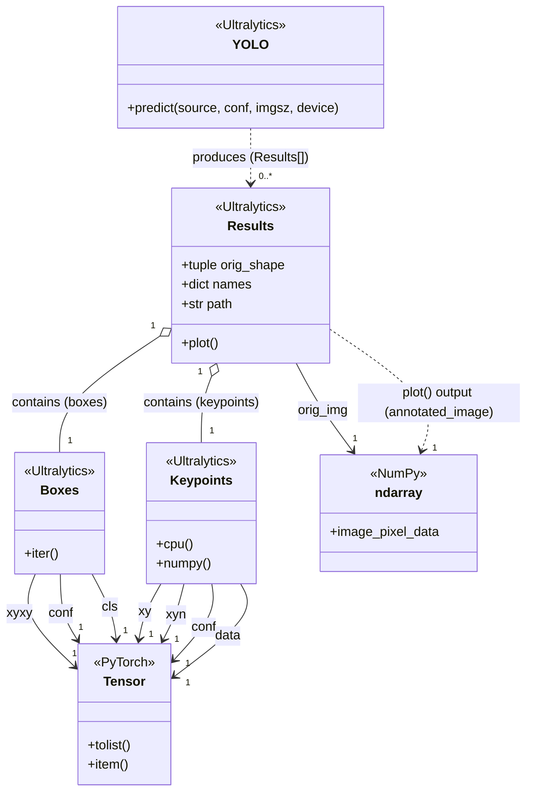
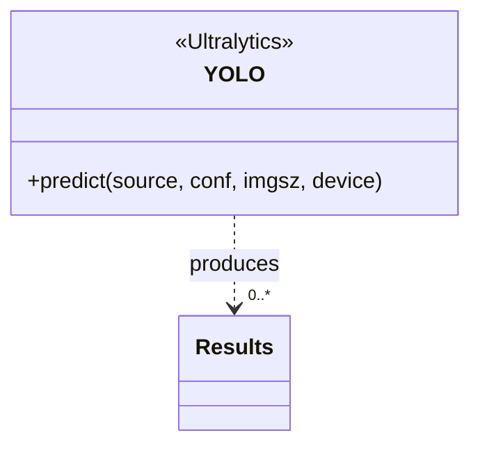
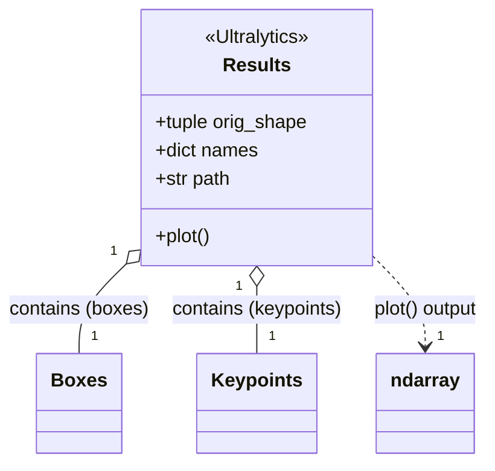
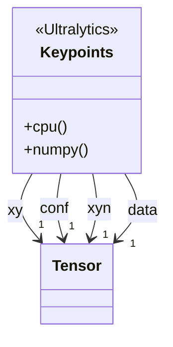
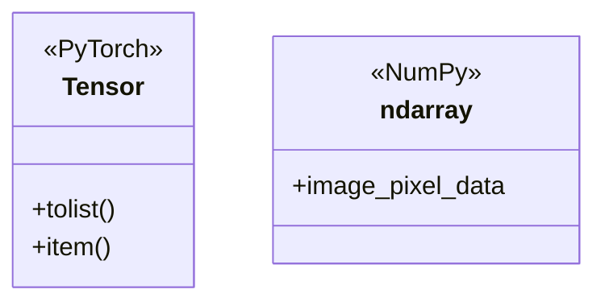

# YOLO Pose Estimation Architecture & Class Diagram

## 1. Visualization Specification (Rules for Diagramming)

This specification governs how object properties and relationships must be rendered in all UML class diagrams across this project:

| Compartment / Category | Definition & Examples | UML Placement |
| :--- | :--- | :--- |
| **1st Compartment (Class Name)** | Unique identifier and package/library stereotype. <br>*(e.g., `«Ultralytics» Keypoints`)* | **Header Block** |
| **2nd Compartment (Attributes)** | Primitive variables (`int`, `float`, `str`, `bool`) and collections holding primitives (`tuple`, `dict`, `list`). <br>*(e.g., `orig_shape: tuple[int, int]`, `names: dict[int, str]`, `path: str`)* | **Inside 2nd Box** |
| **3rd Compartment (Operations)** | Callable functions and methods belonging to the class. <br>*(e.g., `predict()`, `plot()`, `tolist()`, `item()`)* | **Inside 3rd Box** |
| **Outer Relations / Associations** | Non-primitive objects (`Keypoints`, `Boxes`, `Tensor`, `ndarray`) and collections of objects (`Results[]`). | **Connecting Line / Arrow** between class boxes (never written inside the attribute compartment) |

---

## 2. Runtime Class Diagram (`yolo_pose.ipynb`)

This diagram models the execution flow, classes, and data structures inside [`notebooks/yolo_pose.ipynb`](file:///Users/startup/projects/yolotest/notebooks/yolo_pose.ipynb) (Ultralytics YOLO Pose, PyTorch Tensors, OpenCV, and NumPy):



---

### Spec Compliance Breakdown (YOLO Pose Diagram)

| Class | Element | Type Classification | Spec Rule Applied |
| :--- | :--- | :--- | :--- |
| `Results` | `orig_shape` | Collection of primitives (`tuple[int, int]`) | **2nd Box (Attribute)** |
| `Results` | `names` | Collection of primitives (`dict[int, str]`) | **2nd Box (Attribute)** |
| `Results` | `path` | Primitive (`str`) | **2nd Box (Attribute)** |
| `Results` | `plot()` | Method | **3rd Box (Operation)** |
| `Results` | `boxes` | Non-primitive object (`Boxes`) | **Outer Aggregation** (`Results o-- Boxes`) |
| `Results` | `keypoints` | Non-primitive object (`Keypoints`) | **Outer Aggregation** (`Results o-- Keypoints`) |
| `Results` | `orig_img` | Non-primitive object (`ndarray`) | **Outer Association** (`Results --> ndarray`) |
| `Results` | `plot()` output | Non-primitive object (`ndarray`) | **Outer Dependency** (`Results ..> ndarray`) |
| `YOLO` | `predict()` return | Collection of non-primitives (`Results[]`) | **Outer Dependency** (`YOLO ..> "0..*" Results`) |
| `Boxes` | `xyxy`, `conf`, `cls` | Non-primitive objects (`Tensor`) | **Outer Associations** (`Boxes --> Tensor`) |
| `Keypoints` | `xy` *(coordinates [N, 17, 2])* | Non-primitive object (`Tensor`) | **Outer Association** (`Keypoints --> Tensor`) |
| `Keypoints` | `xyn` *(normalized [N, 17, 2])* | Non-primitive object (`Tensor`) | **Outer Association** (`Keypoints --> Tensor`) |
| `Keypoints` | `conf` *(confidences [N, 17])* | Non-primitive object (`Tensor`) | **Outer Association** (`Keypoints --> Tensor`) |
| `Keypoints` | `data` *(raw [x, y, conf])* | Non-primitive object (`Tensor`) | **Outer Association** (`Keypoints --> Tensor`) |
| `Tensor` | `tolist()`, `item()` | Methods | **3rd Box (Operations)** |

---

## 3. Code-to-UML Walkthrough: Connecting `yolo_pose.ipynb` One by One

Here is how each block in the diagram directly connects to the code cells in [`notebooks/yolo_pose.ipynb`](file:///Users/startup/projects/yolotest/notebooks/yolo_pose.ipynb):

---

### Block 1: `«Ultralytics» YOLO` (Pose Model)



#### Code in `yolo_pose.ipynb`:
* **Cell 1** (Loading Pose Weights):
  ```python
  model = YOLO(str(MODEL_PATH))  # Loads yolo11n-pose.pt
  ```
* **Cell 5** (Executing Pose Prediction):
  ```python
  results = model.predict(
      source=str(image_path),
      conf=0.25,
      imgsz=640,
      device="cpu"
  )
  ```

#### How It Maps:
1. **Class Name**: `YOLO`.
2. **3rd Box (Operations)**: `+predict(source, conf, imgsz, device)` is the inference method invoked in Cell 5.
3. **Outer Relation**: `model.predict()` returns `results`, which is a list containing `Results` objects (`Results[]`).

---

### Block 2: `«Ultralytics» Results` (Pose Container)



#### Code in `yolo_pose.ipynb`:
* **Cell 6** (Accessing Boxes and Keypoints):
  ```python
  for person_idx, (box, kpts) in enumerate(zip(results[0].boxes, results[0].keypoints)):
  ```
* **Cell 7** (Rendering Skeleton & Joints):
  ```python
  result_image = results[0].plot()
  ```

#### How It Maps:
1. **2nd Box (Attributes)**:
   * `orig_shape: tuple`: Image dimensions `(height, width)`.
   * `names: dict`: Mapping of class IDs to labels `{0: 'person'}`.
   * `path: str`: String file path of the input image.
2. **3rd Box (Operations)**:
   * `+plot()`: Renders both the bounding boxes and the human skeleton joints.
3. **Outer Relations**:
   * `results[0].boxes` points to the `Boxes` class instance.
   * `results[0].keypoints` points to the `Keypoints` class instance.
   * `results[0].plot()` produces an `ndarray` (NumPy image).

---

### Block 3: `«Ultralytics» Keypoints` (The New Pose Anatomical Class)



#### Code in `yolo_pose.ipynb`:
* **Cell 6** (Accessing Coordinates and Confidences):
  ```python
  # kpts.xy is a PyTorch Tensor holding (x, y) coordinates for all 17 joints
  xy_coords = kpts.xy[0].tolist()

  # kpts.conf is a PyTorch Tensor holding confidence scores for all 17 joints
  conf_scores = kpts.conf[0].tolist()
  ```

#### How It Maps:
1. **Class Name**: `Keypoints` — the dedicated container for human skeletal topology.
2. **2nd Box (Attributes)**: None inside the box, because all joint coordinate structures are PyTorch `Tensor` objects!
3. **3rd Box (Operations)**: `+cpu()`, `+numpy()` to move data across hardware or convert format.
4. **Outer Relations**:
   * `xy`: `Tensor` containing `[N, 17, 2]` joint coordinates in pixel space.
   * `xyn`: `Tensor` containing normalized coordinates in `[0.0, 1.0]` range.
   * `conf`: `Tensor` containing detection confidence scores for each joint.
   * `data`: `Tensor` holding concatenated `[x, y, conf]` matrix.

---

### Block 4: `«PyTorch» Tensor` & `«NumPy» ndarray`



#### Code in `yolo_pose.ipynb`:
* **Cell 6** (Tensor Unpacking):
  ```python
  box_conf = box.conf[0].item()       # Converts scalar Tensor -> float
  xy_coords = kpts.xy[0].tolist()     # Converts [17, 2] Tensor -> Python list
  ```
* **Cell 7 & 8** (NumPy Rendering & Saving):
  ```python
  result_image = results[0].plot()    # Returns ndarray
  cv2.imwrite(str(output_file), result_image)
  ```

---

## 4. Understanding the 17 COCO Keypoints

YOLO Pose tracks **17 standard anatomical joints** on every detected human:

```
                  0. Nose
                 /       \
      1. Left Eye         2. Right Eye
          |                   |
      3. Left Ear         4. Right Ear
              \           /
               \         /
       5. Left Shoulder — 6. Right Shoulder
          /     |             |     \
         /      |             |      \
  7. Left Elbow |             | 8. Right Elbow
        |       |             |       |
  9. Left Wrist |             | 10. Right Wrist
                |             |
           11. Left Hip — 12. Right Hip
               /               \
              /                 \
       13. Left Knee       14. Right Knee
             |                   |
       15. Left Ankle      16. Right Ankle
```

---

## 5. End-to-End Pose Pipeline Flowchart

```mermaid
flowchart LR
    A["dataset/images/*.jpg"] --> B["Image Loader / Path"]
    B -->|image path or matrix| C["YOLO11-Pose (predict)"]
    C -->|Results[]| D["Results (keypoints + boxes)"]
    D -->|plot()| E["Annotated Skeleton (ndarray)"]
    E --> F["runs/pose_estimation/output.jpg"]
```

